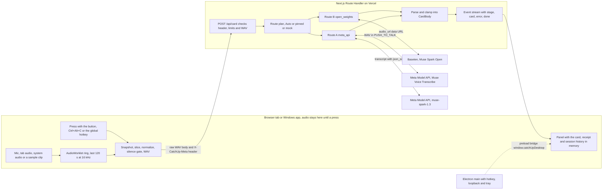

# Catch Up architecture

Catch Up keeps the last 2 minutes of sound in memory, and nothing leaves your device until you press. One press sends the last 30, 60 or 120 seconds to a Meta model and gets back a short card in English, Japanese or Simplified Chinese. The card says whether you were just asked something, gives one line you can say to restate or confirm, a short summary, up to 5 facts with unsure marks, and the key quote. It is a hearing and language aid, never a medical product.

The product spec is `ux-spec.md` in the research folder. This page fixes the boundaries between the six build lanes, so each lane can work alone against compile-checked contracts.

## Data flow



## Module map

Each lane edits only its own paths. Contract files belong to the architect and change only through a new architect pass.

| Lane | Owns | Builds |
| - | - | - |
| card | `src/lib/card/**` except `schema.ts` | prompt, parse and clamp, width clipping, local strings, plain text and Markdown export, receipts, mock fixtures |
| audio | `src/lib/audio/**` except `types.ts`, `src/lib/press/**`, `public/worklets/**` | ring worklet, sources, level meter, silence gate, snapshot, WAV, sample playback, press pipeline and stream reader |
| server | `src/app/api/**`, `src/lib/providers/**` except `types.ts`, `src/lib/server/**` | `/api/card`, `/api/health`, Route B, Route A, mock, Auto fallback, limiter, kill switch, logging |
| ui | `src/app/**` except `src/app/api/**`, `src/components/**`, `src/lib/client/**`, `public/**` except `public/worklets/**` and `public/samples/**` | landing page, Panel, card, history, setup and consent, settings, Document PiP, phone layout, accessibility |
| desktop | `desktop/**` | Electron 45 shell with compact panel, global hotkey, loopback audio, tray, preload bridge, offline page |
| eval | `eval/**`, `scripts/**`, `public/samples/**`, `src/lib/samples/**` | sample catalog and clips, saved real cards, eval runner and table |

| Contract file | What it fixes |
| - | - |
| `src/lib/card/schema.ts` | Card, CardBody, CardMeta, enums, width caps, `widthOf`, the JSON Schema for `response_format`, route labels |
| `src/lib/protocol.ts` | header schema and codec, event types, parser and reader, error codes and copy, limits, health shape, WAV checks, time helpers, `toCard` |
| `src/lib/providers/types.ts` | provider interface, `ProviderError`, Auto policy, `ServerEnv`, env keys and defaults, log entry, handler deps |
| `src/lib/audio/types.ts` | capture engine, snapshot and slice, press pipeline and its events, the Windows app bridge and IPC names |
| `src/lib/copy-rules.ts` | the writing rules as a checker for tests |

Stub files with final signatures sit in each lane and throw until that lane fills them in. `src/lib/card/{prompt,parse,width,strings,format,fixtures}.ts`, `src/lib/audio/engine.ts`, `src/lib/press/press.ts`, `src/lib/providers/index.ts`, `src/lib/server/{env,handle-card}.ts` and `src/lib/samples/catalog.ts`. A lane may add exports, but never changes the signature of one another lane imports.

## HTTP contract

### POST /api/card

| Part | Value |
| - | - |
| Body | the raw WAV bytes (`audio/wav`, 16 kHz, mono, 16-bit PCM), sent as an ArrayBuffer, never a Blob, never base64 |
| Body for a Route A language redo | the earlier transcript as `text/plain; charset=utf-8`, allowed only with route `meta_api` |
| `X-CatchUp-Meta` | base64url JSON of `PressMeta`, built with `encodeMetaHeader` |
| Response | `text/event-stream` read with `readEventStream` |
| Handler | Node runtime (the default, no `runtime` export because Cache Components is on), `maxDuration` 60 |

`PressMeta` fields, and nothing else personal.

| Field | Meaning |
| - | - |
| `v` | protocol version, 1 |
| `pressedAt` | local ISO time with offset of the keydown, pointerdown or hotkey event (`toLocalIso`) |
| `tz` | IANA time zone, used to resolve relative dates |
| `cardLang`, `meetingLang` | card language and the language people around usually speak (`en`, `ja`, `zh`) |
| `windowSec`, `sentSec` | 30, 60 or 120, and the seconds actually sent |
| `source` | `mic`, `tab`, `system` or `sample` |
| `names` | up to 3 forms people call the listener, 60 width units in all |
| `hint` | optional names or topics to expect, 120 width units |
| `route` | `auto`, `open_weights`, `meta_api` or `mock` |
| `sessionId` | random per page session, used only as `x-session-affinity` at Baseten |
| `mock` | dev only, mode `ok`, `slow`, `error` or `badjson` plus an optional fixture kind |

Events, in order. A card is never blank, so every successful stream carries exactly one card.

| Event | Data | UI text |
| - | - | - |
| `stage` | `{ name: "received" }` once the body is accepted | Listening back |
| `stage` | `{ name: "writing" }` at the first answer token | Writing your card |
| `stage` | `{ name: "fallback" }` when Auto switches to Route A | Trying the backup route (Meta Model API) |
| `card` | `WireCard`, the CardBody plus the server meta (route, model, fallback, transcript, parse quality, timing, usage) | the card |
| `error` | `{ code, retryable, stored: false, route?, cause?, retryAfterSec? }` | see the error table |
| `done` | `{}` | |

Errors found before streaming starts (bad header, limits, kill switch, bad WAV) come back as a complete event stream with the mapped HTTP status, built by `errorEventResponse`. Errors after the first stage arrive as an `error` event on a 200 stream. A response that is not an event stream (for example Vercel's own 413) maps through `errorCodeFromStatus`. The client turns a `WireCard` into a `Card` with `toCard`, adding id, press time, window, sent seconds, source, timings and bytes.

### GET /api/health

Returns `HealthResponse`. Which live routes have keys and their model ids, whether live calls are on (`paused` is `live_off` or `daily_cap` otherwise), the route used for Auto, whether mock is allowed here, and the public limits. It never returns keys. The handler calls `connection()` first so it runs per request under Cache Components.

## Providers and the Auto fallback

| Route | Id | Host and models | Request |
| - | - | - | - |
| B, primary | `open_weights` | Baseten Chat Completions, `meta-models/muse-spark-open-1026`, then `meta-models/muse-spark-open` once on 404 | text part then the WAV as an `audio_url` data URL (one retry with `input_audio` on 400), `reasoning_effort` low, `max_tokens` 2048, streaming, `x-session-affinity`. Accept only `finish_reason` stop with an empty refusal. JSON is asked for, not enforced, so the server parses and clamps |
| A, backup | `meta_api` | Meta Model API, `muse-voice-transcribe-1.0` then `muse-spark-1.3` | Voice Transcribe file endpoint in PUSH_TO_TALK with languageBias and keywords from names and hint, then the transcript as text with `META_RESPONSE_FORMAT` (json_schema, strict false) and `reasoning_effort` minimal. Never audio to 1.3, never a contributor model |
| mock | `mock` | none | fixtures from `mockCardBody`, stages at 0.3 s and 1.2 s and the card at 2.8 s. Only with `ALLOW_MOCK=1` outside production |
| cached | (client) | none | a saved real result for a public sample clip, labeled with its run date, served by the press pipeline from `getCachedCard` when a live call fails, is capped or is off |

Auto, in order.

1. A press asking for `auto` uses `CATCHUP_ROUTE`. A named route (from Advanced settings or `CATCHUP_ROUTE`) is pinned and never falls back.
2. Auto runs the configured routes in `AUTO_POLICY.order`, Route B first. A route without a key is skipped, not counted as a fallback.
3. Route A runs once, with the same clip, when Route B fails with a code in `AUTO_POLICY.fallbackOn`, when its output does not parse, or when it has no answer token by `AUTO_FALLBACK_MS` (8 s until gate 1 retunes it to the p95 of Route B plus 1 s). The server then emits the `fallback` stage and the card carries `fallbackFrom` and `fallbackCause`.
4. When every route fails and some model text exists, the server sends an Unformatted card with that raw text in `summary[0]`. Otherwise it sends an `error` event.
5. The client aborts at 20 s. The server stops providers at 19 s and sends `timeout`.

Parsing happens on the server before the card event. `parseCardText` strips control tokens and code fences, takes the outermost braces, parses, clamps unknown enums to safe values and long strings to their width caps, and applies the teen and tens backstop. Providers resolve with a valid CardBody or reject with a `ProviderError`, whose message never contains model text.

## Environment variables

Keys live only in `.env.local` (git-ignored) or Vercel env, are read only on the server, never use `NEXT_PUBLIC_`, and are never logged, printed or committed. `.env.example` lists every variable with its default, and a test keeps it in sync with `ENV_KEYS` and `ENV_DEFAULTS`.

| Variable | Default | Purpose |
| - | - | - |
| `BASETEN_API_KEY` | empty | Route B key |
| `BASETEN_BASE_URL` | `https://inference.baseten.co/v1` | Baseten endpoint |
| `BASETEN_MODEL` | `meta-models/muse-spark-open-1026` | hackathon slug |
| `BASETEN_MODEL_FALLBACK` | `meta-models/muse-spark-open` | tried once on 404 |
| `BASETEN_MAX_TOKENS` | 2048 | output budget with reasoning |
| `BASETEN_TEMPERATURE` | 1.0 | decided at gate 1 against 0.3 |
| `BASETEN_TOP_K` | empty | empty leaves it out, -1 turns top-k off |
| `MODEL_API_KEY` | empty | Route A key |
| `META_BASE_URL` | `https://api.meta.ai/v1` | Meta Model API endpoint |
| `META_CARD_MODEL` | `muse-spark-1.3` | card writer on the transcript |
| `META_ASR_MODEL` | `muse-voice-transcribe-1.0` | transcription |
| `META_MAX_COMPLETION_TOKENS` | 4000 | output budget with reasoning |
| `CATCHUP_ROUTE` | `auto` | route used when a press asks for auto |
| `LIVE_ENABLED` | 1 | kill switch, 0 stops live calls |
| `ALLOW_MOCK` | 0 | 1 allows mock in dev and tests, production refuses it |
| `RATE_LIMIT_PER_HOUR` | 30 | presses per client IP per hour, in memory |
| `DAILY_PRESS_CAP` | 500 | live presses per server instance per UTC day |
| `AUTO_FALLBACK_MS` | 8000 | Route B first-token deadline under Auto |

## Error codes

The UI shows the English copy from `ERROR_COPY_EN`, then one action. Every error says whether anything was sent, and `stored` is always false.

| Code | HTTP before streaming | Retryable | Action | When |
| - | - | - | - | - |
| `bad_request` | 400 | no | Reload | header or body unreadable |
| `bad_audio` | 400 | no | Check source | not 16 kHz mono PCM16, or under 1 s |
| `too_large` | 413 | no | none | over 4.4 MB or 125 s |
| `rate_limited` | 429 | yes | Try a sample | per-IP hourly limit |
| `daily_cap` | 503 | no | Try a sample | server daily cap reached |
| `live_off` | 503 | no | Try a sample | `LIVE_ENABLED` is 0 |
| `not_configured` | 503 | no | Try a sample | no key for the route asked for |
| `mock_refused` | 403 | no | none | mock asked for in production |
| `timeout` | 504 | yes | Retry, or Use the other route | 20 s hard cap |
| `provider_error` | 502 | yes | Retry, or Use the other route | model service failed |
| `server_error` | 500 | yes | Retry | unexpected server failure |
| `offline` | client only | yes | Retry | the device is offline, nothing sent |
| `network` | client only | yes | Retry | fetch failed while online |
| `aborted` | client only | no | none | Esc or Cancel |

`cause` adds the provider failure (`http`, `rate_limited`, `timeout`, `no_token`, `bad_json`, `refused`, `length`, `empty` and others in `PROVIDER_FAILURES`) and never carries content.

## Privacy invariants

1. Audio lives only in the AudioWorklet ring and in press snapshots, as typed arrays in memory. Nothing uses IndexedDB, localStorage, Cache Storage or Blob storage for audio.
2. Audio leaves the device only on a press, and only the slice shown on the memory bar. The silence gate sends nothing when no one spoke.
3. Pause stops every track (the OS indicator goes off) and zeroes the ring and every snapshot. A press snapshot is zeroed after 2 minutes.
4. The server streams straight through. It never stores audio, transcripts or card text, and it calls providers synchronously only.
5. Server logs hold one `PressLogEntry` per press with time, route, model, window, bytes, stage timings and status. Never audio, transcripts, card text, names, hints, IP addresses or keys.
6. Names and the hint travel only inside a press, in the header, and are kept on the device in settings.
7. Settings are the only thing kept on the device. History stays in the tab, and Export is the only path to disk.
8. Every listening session starts with the People here know confirmation. The panel always shows up in screen shares, and nothing calls `setContentProtection`.
9. Mock never reaches production, and cached cards are always labeled with their run date.

## Limits

| Limit | Value |
| - | - |
| Ring memory | 120 s at 16 kHz mono |
| Clip format | WAV, 16 kHz, mono, 16-bit PCM, 32,000 bytes per second |
| Clip length on the server | 1 s to 125 s |
| Request body | 4,400,000 bytes (Vercel caps at 4.5 MB) |
| Transcript body | 16,000 bytes |
| Header | 4,096 characters |
| Names and hint | 60 and 120 width units (CJK counts 2) |
| Warm-up before a press | 5 s in memory |
| Hard cap | 20 s from press to card or error |
| Snapshot hold | 2 minutes |
| Rate limit and daily cap | 30 per IP per hour, 500 live presses per day, both best effort and in memory |

## Timing budget

Targets until gate 1 measures them with real keys.

| Step | Target |
| - | - |
| Stall line on screen | 0 ms after the press |
| Snapshot, slice, normalize and encode | under 100 ms, encode under 50 ms |
| Upload of a 30 s clip (0.96 MB) | under 1 s on a typical uplink |
| Still working note | at 6 s |
| Auto switch to Route A | 8 s without an answer token from Route B |
| Full card | p50 under 5 s, p95 under 8 s |
| Hard cap | 20 s |

## Commands

```bash
npm run typecheck   # tsc --noEmit
npm test            # vitest run, node environment, add // @vitest-environment jsdom for DOM tests
npm run lint        # eslint
npm run eval        # tsx eval/run.ts
```

The Windows app in `desktop/` is its own npm project and runs from source. It is not part of the web build, the type check or lint.
