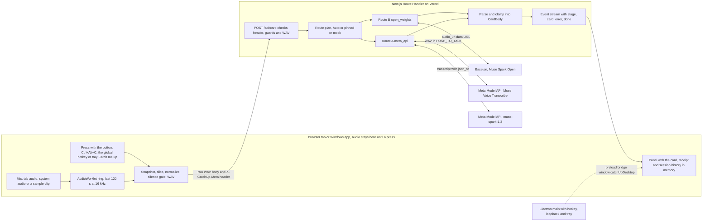

# Catch Up architecture

Catch Up keeps the last 2 minutes of sound in memory, and nothing leaves your device until you press. One press sends the last 30, 60 or 120 seconds to a Meta model and gets back a short card in English, Japanese or Simplified Chinese. The card says whether you were just asked something, gives one line you can say to restate or confirm, a short summary, up to 5 facts with unsure marks, and the key quote. Catch Up is an accessibility and language tool, not a medical device.

The product spec is `ux-spec.md` in the research folder. This page fixes the boundaries between the six build lanes, so each lane can work alone against compile-checked contracts.

## Data flow



## Module map

Each lane edits only its own paths. Contract files belong to the architect and change only through a new architect pass.

| Lane | Owns | Builds |
| - | - | - |
| card | `src/lib/card/**` except `schema.ts` | prompt, parse and clamp, width clipping, local strings, plain text and Markdown export, receipts, mock fixtures |
| audio | `src/lib/audio/**` except `types.ts`, `src/lib/press/**`, `public/worklets/**` | ring worklet, sources, level meter, silence gate, snapshot, WAV, sample playback, press pipeline and stream reader |
| server | `src/app/api/**`, `src/lib/providers/**` except `types.ts`, `src/lib/server/**` | `/api/card`, `/api/health`, Route B, Route A, mock, Auto fallback, guards, kill switch, logging |
| ui | `src/app/**` except `src/app/api/**`, `src/components/**`, `src/lib/client/**`, `public/**` except `public/worklets/**` and `public/samples/**` | landing page, Panel, card, history, setup and consent, settings, Document PiP, phone layout, accessibility |
| desktop | `desktop/**` | Electron 45 shell with compact panel, global hotkey, loopback audio, tray, preload bridge, offline page |
| eval | `eval/**`, `scripts/**`, `public/samples/**`, `src/lib/samples/**` | sample catalog and clips, saved real cards, eval runner and table |

| Contract file | What it fixes |
| - | - |
| `src/lib/card/schema.ts` | Card, CardBody, CardMeta with the sent record and the cached fields, enums, width caps, `widthOf`, the JSON Schema for `response_format`, route labels and `routeLabelOf` |
| `src/lib/protocol.ts` | header schema and codec, `normalizeNames` and `normalizeHint`, event types, parser and reader, error copy, limits, health shape, WAV checks, time helpers, `toCard` |
| `src/lib/codes.ts` | error codes and provider failures, re-exported by `protocol.ts` so the schema can use them without an import cycle |
| `src/lib/providers/types.ts` | provider interface, `ProviderError`, Auto policy, the exact request bodies and roles of both routes, the Voice Transcribe constants and `buildAsrRequest`, `ServerEnv`, env keys and defaults, log entry, handler deps |
| `src/lib/audio/types.ts` | capture engine and its states, snapshot and slice, press pipeline and its events, the Windows app bridge and IPC names |
| `src/lib/copy-rules.ts` | the writing rules as a checker for tests |

Stub files with final signatures sit in each lane and throw until that lane fills them in. `src/lib/card/{prompt,parse,width,strings,format,fixtures}.ts`, `src/lib/audio/engine.ts`, `src/lib/press/press.ts`, `src/lib/providers/index.ts`, `src/lib/server/{env,handle-card}.ts` and `src/lib/samples/catalog.ts`. Their doc comments are part of the contract. A lane may add exports, but never changes the signature of one another lane imports. Tests that reach a stub from another lane mock it with `vi.mock` until that lane lands.

## HTTP contract

### POST /api/card

| Part | Value |
| - | - |
| Body | the raw WAV bytes (`audio/wav`, 16 kHz, mono, 16-bit PCM), sent as an ArrayBuffer, never a Blob, never base64 |
| Body for a Route A language redo | the earlier transcript as `text/plain; charset=utf-8`, allowed only with route `meta_api` |
| `X-CatchUp-Meta` | base64url JSON of `PressMeta`, built with `encodeMetaHeader` |
| Response | `text/event-stream` read with `readEventStream` |
| Handler | Node runtime (the default, no `runtime` export because Cache Components is on), `maxDuration` 60 |

`PressMeta` fields, and nothing else personal. The press pipeline runs the raw names through `normalizeNames` and the raw hint through `normalizeHint` first, because `encodeMetaHeader` throws on blank names, an empty hint or anything over the width caps.

| Field | Meaning |
| - | - |
| `v` | protocol version, 1 |
| `pressedAt` | local ISO time with offset of the keydown, pointerdown, hotkey event or tray click (`toLocalIso`) |
| `tz` | IANA time zone, used to resolve relative dates |
| `cardLang`, `meetingLang` | card language and the language people around usually speak (`en`, `ja`, `zh`) |
| `windowSec`, `sentSec` | 30, 60 or 120, and the seconds actually sent |
| `source` | `mic`, `tab`, `system` or `sample` |
| `names` | up to 3 forms people call the listener, 60 width units in all |
| `hint` | optional names or topics to expect, 120 width units |
| `route` | `auto`, `open_weights`, `meta_api` or `mock` |
| `sessionId` | random per page session, used only as `x-session-affinity` at Baseten |
| `mock` | dev only, mode `ok`, `slow`, `error` or `badjson` plus an optional fixture kind |

Events, in order. A card is never blank, so every successful stream carries exactly one card.

| Event | Data | UI text |
| - | - | - |
| `stage` | `{ name: "received" }` once the body is accepted | Listening back |
| `stage` | `{ name: "writing" }` at the first answer token | Writing your card |
| `stage` | `{ name: "fallback" }` when Auto switches to Route A | Trying the backup route (Meta Model API) |
| `card` | `WireCard`, the CardBody plus the server meta (route, model, fallback, transcript, parse quality, timing, usage) | the card |
| `error` | `{ code, retryable, stored: false, route?, cause?, retryAfterSec? }` | see the error table |
| `done` | `{}` | |

Errors found before streaming starts (bad header, guards, kill switch, bad WAV) come back as a complete event stream with the mapped HTTP status, built by `errorEventResponse`. Errors after the first stage arrive as an `error` event on a 200 stream. A response that is not an event stream (for example Vercel's own 413) maps through `errorCodeFromStatus`. The client turns a `WireCard` into a `Card` with `toCard`, adding id, press time, window, sent seconds, source, timings, bytes and the sent record.

`meta.model` always names what served the card. On Route B it is the slug that answered. On Route A it is `routeAModelLabel(asr, card)` for audio and the card model alone for a transcript redo.

### GET /api/health

Returns `HealthResponse`. Which live routes have keys and their model ids, whether live calls are on (`paused` is `live_off` when the kill switch is off), the route used for Auto, whether mock is allowed here, and the public limits (`perHour` 0 means no per-client limit). It never reports `daily_cap`, because the cap lives in each instance's memory and on Vercel `/api/card` runs in another function, so a capped press says so in its own error. It never returns keys. The handler calls `connection()` first so it runs per request under Cache Components.

The page reads health once. When it says the kill switch is off, or the route a press would take has no key, the press fails on the device with `live_off` or `not_configured` and `sent` false, so no clip is uploaded for the server to refuse unread.

## Providers and the Auto fallback

| Route | Id | Host and models | Request |
| - | - | - | - |
| B, primary | `open_weights` | Baseten Chat Completions, `BASETEN_MODEL` (`meta-models/muse-spark-open-1026`) in production and in the demo | a `BasetenChatBody` with a `system` message, the text part, then the WAV as an `audio_url` data URL |
| A, backup | `meta_api` | Meta Model API, `muse-voice-transcribe-1.0` then `muse-spark-1.3` | `buildAsrRequest` in PUSH_TO_TALK, then a `MetaChatBody` with a `developer` message, the transcript as text and `META_RESPONSE_FORMAT` |
| mock | `mock` | none | fixtures from `mockCardBody`, stages at 0.3 s and 1.2 s and the card at 2.8 s. Only with `ALLOW_MOCK=1` outside production |
| cached | (client) | none | a saved real result for a public sample clip, labeled with its saved route and run date, served by the press pipeline from `getCachedCard` when a live call fails, is capped or is off |

### Route B request

1. The body has exactly the fields in `BASETEN_BODY_FIELDS` (model, messages, stream, stream_options, reasoning_effort, max_tokens, temperature, top_k), because Baseten's request schema is closed. temperature and top_k are left out when `ServerEnv` holds null for them.
2. The first message has role `system` (`ROUTE_B.instructionRole`), since Baseten's role enum has no `developer`. It holds `systemPrompt()`. The user message holds the `userText()` part first and the WAV second, as `data:audio/wav;base64,...` in an `audio_url` part.
3. `reasoning_effort` low, `stream` true with `stream_options.include_usage`, `max_tokens` from env, and `x-session-affinity` set to `sessionId` and nothing else.
4. A 400 gets one retry with an `input_audio` part. Only `delta.content` is read. A card is accepted only after `finish_reason` stop, an empty refusal and `[DONE]`.
5. The public slug is a dev convenience only. `BASETEN_MODEL_FALLBACK` is empty by default and `readServerEnv` drops it in production, so the deployed app never leaves the hackathon slug quietly. In dev, when the main slug answers 403 or 404, the fallback slug is tried once and the miss is remembered for the life of the server instance, so later presses skip the failing slug. Shipping the public slug on purpose means changing `BASETEN_MODEL` itself.

### Route A request

1. Transcription is a multipart POST to `META_ASR.path` with the JSON part `request` and the file part `audio` (`clip.wav`). The request comes from `buildAsrRequest`. model, `audioEncoding` WAV, `mode` PUSH_TO_TALK, `languageBias` and `keywords`. Meta ignores unknown mode and field names silently, so these values come only from the typed constants in `providers/types.ts`.
2. `languageBias` holds language names, never codes, from `ASR_LANGUAGE_NAMES` (English, Japanese, Mandarin Chinese), the meeting language first and then the card language. Gate 1 checks the Mandarin name, since an unknown name is ignored without an error.
3. `keywords` are the name forms plus the hint split on commas (also 、 and ，), trimmed, without repeats, at most 20.
4. The card call has exactly the fields in `META_CHAT_BODY_FIELDS`. A `developer` message with `systemPrompt()`, a user message with `userText()` including the transcript, `reasoning_effort` minimal, `max_completion_tokens` from env, `response_format` set to `META_RESPONSE_FORMAT` (json_schema, strict false), and streaming with `include_usage`. No temperature, top_p, stop, n or penalties.
5. A transcript body skips transcription. Audio never goes to muse-spark-1.3, and no contributor model is ever called. `readServerEnv` keeps the default when `META_CARD_MODEL` or `META_ASR_MODEL` names an id ending in `-contributor`.

### Auto, in order

1. A press asking for `auto` uses `CATCHUP_ROUTE`. A named route (from Advanced settings or `CATCHUP_ROUTE`) is pinned and never falls back.
2. Auto runs the configured routes in `AUTO_POLICY.order`, Route B first. A route without a key is skipped, not counted as a fallback.
3. Route A runs once, with the same clip, when Route B fails with a code in `AUTO_POLICY.fallbackOn`, when its output does not parse, or when it has no answer token by `AUTO_FALLBACK_MS` (8 s until gate 1 retunes it to the p95 of Route B plus 1 s). The server then emits the `fallback` stage and the card carries `fallbackFrom` and `fallbackCause`.
4. When every route fails and some model text exists, the server sends an Unformatted card with that raw text in `summary[0]`. Otherwise it sends an `error` event.
5. The client aborts at 30 s. The server stops providers at 29 s and sends `timeout`. The eval runner allows 35 s for the handler and stream to finish.

Parsing happens on the server before the card event. `parseCardText` strips control tokens and code fences, takes the outermost braces, parses, clamps unknown enums to safe values and long strings to their width caps, and applies the teen and tens backstop. Its `ClampContext` holds the card language and the meeting language, so a card with heard poor and no say gets the repeat line in the meeting language, with a gloss in the card language when they differ. Providers resolve with a valid CardBody or reject with a `ProviderError`, whose message never contains model text.

## Server guards

Checks run in this order. Header, the route plan (mock refusal, kill switch, keys and Meta's geographic use policy), the per-client hourly limit, the daily cap, an in-flight slot for the client, then the body. A press is refused by a guard before its body is read, but it counts toward the guards only once its body passes. At that point `admit` checks both limits again and counts the press in the same synchronous step, so presses that passed the early checks together during their uploads can never overshoot either limit.

1. The hourly limit (`RATE_LIMIT_PER_HOUR`, 30) and the daily cap (`DAILY_PRESS_CAP`, 500) count live presses only. Mock presses never count toward either.
2. One client has at most 2 live presses in flight (`MAX_IN_FLIGHT`), from the upload to the end of the stream. Every refusal frees the slot, and the stream frees it when it ends.
3. The client key is `clientKeyOf` in `src/lib/server/where.ts`. On Vercel it is `x-real-ip`, with an IPv6 address cut to its /64. Anywhere else forwarding headers are ignored and the key is `local` (`LOCAL_CLIENT_KEY`), because Next sets `x-forwarded-for` only when it is missing and a tunnel appends to it.
4. On Vercel, a caller whose `x-vercel-ip-country` (and for Ukraine `x-vercel-ip-country-region`) is a territory in Meta's geographic use policy never reaches Route A. Auto keeps only Route B, and a press pinned to `meta_api` is refused with `not_configured`.
5. `RATE_LIMIT_PER_HOUR` 0 turns every per-client limit off (hourly and in flight), for a local eval server only. `DAILY_PRESS_CAP` stays 1 or more.
6. The eval in process passes `deps.env` with `ratePerHour` 0 and `deps.clientKey` with one key per run. Over HTTP, `--base-url` accepts only localhost or 127.0.0.1, against a server started with `RATE_LIMIT_PER_HOUR=0`. The eval never runs against the deployed URL, so it never spends the deployed app's daily cap.

## Client contract

### Capture

1. `start()` asks for the mic or the share synchronously inside the click, before any await.
2. Every paused state has zeroed the ring and every snapshot, whatever the reason (user, interrupted, source_lost, replaced or sample_ended).
3. A finished sample stays `listening` with `endedAt` set. The ring stops filling and level readings stop, but the clip stays in memory, so a judge can still press after the clip ends. It is zeroed by a new `start()`, by `pause()`, or 2 minutes after the end, which moves the status to paused with reason sample_ended.

### Press

1. `pressed` with the stall line comes at 0 ms, then sending, stage, still_working at 6 s, and card or error. One press at a time, with a 30 s hard cap. `pressedAt` is the moment the card is about and every redo keeps it. `startedAt` is when this attempt started, and the elapsed counter and the cancel guard count from it.
2. Esc or Cancel emits `cancelled` only, never an error event, and the UI shows the `aborted` copy for it. The `aborted` error code is kept for a press that ends without Esc or Cancel, for example `dispose()` mid-press.
3. A header that fails to encode becomes the `bad_request` error with `sent` false.
4. Every card carries `meta.sent`, which says whether audio, the earlier transcript or nothing left the device, and whether names and the hint travelled with it.
5. When a live call for a sample fails, is capped or is off, the press shows the saved card from `getCachedCard`, with a new id, this press's time and sent record, and `meta.cachedBecause`. Its route stays `cached`, with `cachedFrom` and `cachedRunAt` from the saved run. A sample press sends the clip's listener names and never the visitor's session hint.
6. Further back sends the next window (60, then 120 s) of the held snapshot only while there is something older. A partial card, or memory that holds no more than half a second past what was sent, refuses it as `nothing_more`, and the UI hides the button.
7. Send anyway marks the held press, so a language chip or Further back on the card it produced skips the silence gate too.
8. A press cancelled while its snapshot is pending drops that snapshot when a newer press has already asked for its own.

### Receipt

`receiptText` writes one English receipt per card. It names the window, the route label from `routeLabelOf` (plus the backup route when `fallbackFrom` is set), the model id from `meta.model`, the card time in seconds, the clock time of the press and what `meta.sent` says left the device, and it always ends with Catch Up saved nothing. A cached card says why it stood in and names its saved run without claiming a model got this press. A mock card says no model was called. Model ids are exempt from the writing rules, and `copyRuleProblems` skips them.

### Windows app bridge

1. Presses from the main process use one channel. The global hotkey and tray Catch me up both send `DESKTOP_IPC.hotkey` with a `DesktopPressPayload` (`at`, `via`, `accelerator`), and the page treats them the same. `DesktopCommand` is pause or resume only.
2. `DESKTOP_IPC.hotkeyChanged` carries `DesktopHotkeyState` after startup registration, a preset fallback, `setHotkey` or a tray preset pick, and the bridge exposes it as `onHotkeyChange`, so the panel hint never goes stale.

### Sample catalog

`src/lib/samples/catalog.ts` runs in the browser, so it never imports fs, path, node modules or server code, and never lists a folder. Synthetic dev clips are a static list (`DEV_SAMPLE_CLIPS`) with fixed file names under `/samples/dev/`, written to match `eval/clips.json`, and `listSampleClips` adds them only when NODE_ENV is not production.

## Environment variables

Keys live only in `.env.local` (git-ignored) or Vercel env, are read only on the server, never use `NEXT_PUBLIC_`, and are never logged, printed or committed. `.env.example` pins `CATCHUP_ROUTE=meta_api` for the Meta-only build. Other example values match the code defaults, and a test keeps the variable list and these choices in sync with `ENV_KEYS` and `ENV_DEFAULTS`.

| Variable | Default | Purpose |
| - | - | - |
| `BASETEN_API_KEY` | empty | Route B key |
| `BASETEN_BASE_URL` | `https://inference.baseten.co/v1` | Baseten endpoint |
| `BASETEN_MODEL` | `meta-models/muse-spark-open-1026` | hackathon slug, used in production and in the demo |
| `BASETEN_MODEL_FALLBACK` | empty | dev only, set in `.env.local`, tried once on 403 or 404, ignored in production |
| `BASETEN_MAX_TOKENS` | 2048 | output budget with reasoning |
| `BASETEN_TEMPERATURE` | 1.0 | decided at gate 1 against 0.3 |
| `BASETEN_TOP_K` | empty | empty leaves it out, -1 turns top-k off |
| `MODEL_API_KEY` | empty | Route A key |
| `META_BASE_URL` | `https://api.meta.ai/v1` | Meta Model API endpoint |
| `META_CARD_MODEL` | `muse-spark-1.3` | card writer on the transcript, a contributor id is ignored |
| `META_ASR_MODEL` | `muse-voice-transcribe-1.0` | transcription, a contributor id is ignored |
| `META_MAX_COMPLETION_TOKENS` | 4000 | output budget with reasoning |
| `CATCHUP_ROUTE` | `auto` in code, `meta_api` in the example | route used when a press asks for auto |
| `LIVE_ENABLED` | 1 | kill switch, 0 stops live calls |
| `ALLOW_MOCK` | 0 | 1 allows mock in dev and tests, production refuses it |
| `RATE_LIMIT_PER_HOUR` | 30 | live presses per client per hour, in memory, 0 turns the per-client limits off for a local eval server |
| `DAILY_PRESS_CAP` | 500 | live presses per server instance per UTC day, 1 or more |
| `AUTO_FALLBACK_MS` | 8000 | Route B first-token deadline under Auto |

## Error codes

The UI shows the English copy from `ERROR_COPY_EN`, then one action. Every error says whether anything was sent, and `stored` is always false. Try a sample shows only when a sample has a saved real card (`hasCachedSamples`), otherwise a paused error says to try again later. The other route button names where it sends the clip and shows only under Auto, never for a pinned route.

| Code | HTTP before streaming | Retryable | Action | When |
| - | - | - | - | - |
| `bad_request` | 400 | no | Reload | header or body unreadable, or the header failed to encode on the device |
| `bad_audio` | 400 | no | Check source | not 16 kHz mono PCM16, or under 1 s |
| `too_large` | 413 | no | none | over 4.4 MB or 125 s |
| `rate_limited` | 429 | yes | Try a sample | per-client hourly limit, or 2 presses already in flight |
| `daily_cap` | 503 | no | Try a sample | server daily cap reached |
| `live_off` | 503 | no | Try a sample | `LIVE_ENABLED` is 0 |
| `not_configured` | 503 | no | Try a sample | no key for the route asked for |
| `mock_refused` | 403 | no | none | mock asked for in production |
| `timeout` | 504 | yes | Retry, or Send to the other route under Auto | 30 s client cap, 29 s server deadline |
| `provider_error` | 502 | yes | Retry, or Send to the other route under Auto | model service failed |
| `server_error` | 500 | yes | Retry | unexpected server failure |
| `offline` | client only | yes | Retry | the device is offline, nothing sent |
| `network` | client only | yes | Retry | fetch failed while online |
| `aborted` | client only | no | none | the press ended without Esc or Cancel, for example `dispose()`. Esc and Cancel emit `cancelled` and reuse this copy |

`cause` adds the provider failure (`http`, `rate_limited`, `timeout`, `no_token`, `bad_json`, `refused`, `length`, `empty` and others in `PROVIDER_FAILURES`) and never carries content.

## Privacy invariants

1. Audio lives only in the AudioWorklet ring and in press snapshots, as typed arrays in memory. Nothing uses IndexedDB, localStorage, Cache Storage or Blob storage for audio.
2. Audio leaves the device only on a press, and only the slice shown on the memory bar. The silence gate sends nothing when no one spoke.
3. Pause stops every track (the OS indicator goes off) and zeroes the ring and every snapshot. A press snapshot is zeroed after 2 minutes, and so is a finished sample clip.
4. The server streams straight through. It never stores audio, transcripts or card text, and it calls providers synchronously only.
5. Server logs hold one `PressLogEntry` per press with time, route, model, window, bytes, stage timings and status. Never audio, transcripts, card text, names, hints, IP addresses or keys.
6. Names and the hint travel only inside a press, in the header, and are kept on the device in settings.
7. Settings are the only thing kept on the device. History stays in the tab, and Export is the only path to disk.
8. Every listening session starts with the People here know confirmation. The panel always shows up in screen shares, and nothing calls `setContentProtection`.
9. Mock never reaches production. Cached cards always name the route of their saved run and its date.
10. Every receipt names the route and model id and ends with Catch Up saved nothing, which is the only retention claim Catch Up makes.

## Limits

| Limit | Value |
| - | - |
| Ring memory | 120 s at 16 kHz mono |
| Clip format | WAV, 16 kHz, mono, 16-bit PCM, 32,000 bytes per second |
| Clip length on the server | 1 s to 125 s |
| Request body | 4,400,000 bytes (Vercel caps at 4.5 MB) |
| Transcript body | 16,000 bytes |
| Header | 4,096 characters |
| Names and hint | 60 and 120 width units (CJK counts 2) |
| Warm-up before a press | 5 s in memory |
| Hard cap | 30 s from press to card or error, server stops providers at 29 s |
| Snapshot hold | 2 minutes, also for a finished sample |
| Hourly limit and daily cap | 30 live presses per client per hour, 2 in flight per client, 500 live presses per day, all best effort and in memory, mock exempt |

## Timing behavior

The 30 s cap allows room for slower requests on the two-step Meta route. It is a cancellation limit, not a response-time guarantee. See the README and eval reports for measured latency and the audio source used. `TIMING_BUDGET` retains the original optimization targets for future work, not claims about current performance.

| Step | Target |
| - | - |
| Stall line on screen | 0 ms after the press |
| Snapshot, slice, normalize and encode | under 100 ms, encode under 50 ms |
| Upload of a 30 s clip (0.96 MB) | under 1 s on a typical uplink |
| Still working note | at 6 s |
| Auto switch to Route A | 8 s without an answer token from Route B |
| Full card | measured in evaluation, depends on the route and clip |
| Hard cap | 30 s on the client, 29 s on the server |

## Commands

```bash
npm run typecheck   # tsc --noEmit
npm test            # vitest run, node environment, add // @vitest-environment jsdom for DOM tests
npm run lint        # eslint
npm run eval        # tsx eval/run.ts
```

The Windows app in `desktop/` is its own npm project and runs from source. It is not part of the web build, the type check or lint.
